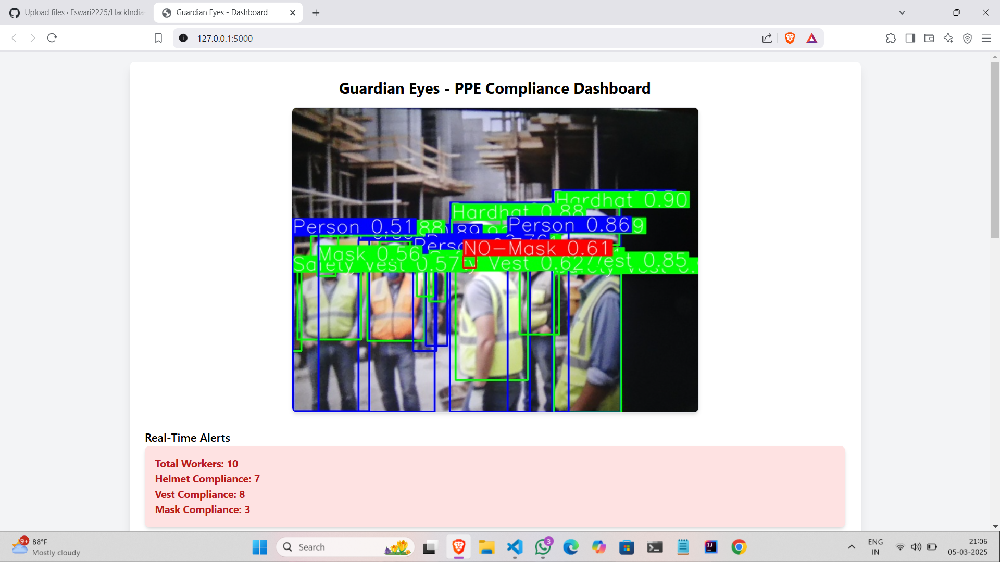
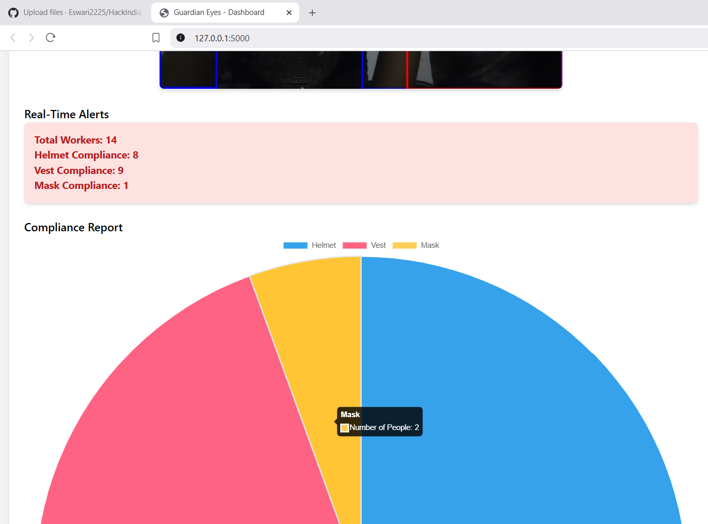

# 🦺 Guardian Eyes — AI-Powered Safety Monitoring System

<div align="center">


**AI-powered safety monitoring using computer vision and object detection.**

[View Repository](https://github.com/Eswari2225/HackIndia-Spark-2-2025---Code-Crusaders)

</div>

---

## 📌 About the Project

**Guardian Eyes** is a computer vision project developed by Team Code Crusaders for HackIndia Spark 2 – 2025.

The project uses the YOLOv8 object detection model to analyze visual input and identify safety-related conditions. It includes a Python application, a web dashboard, and an alert module.

## 🎯 Problem Statement

Manual safety monitoring can be time-consuming in environments where protective equipment is required. Guardian Eyes explores how computer vision can help identify safety-related violations and support more efficient monitoring.

## 💡 Proposed Solution

The system combines AI-based object detection with a web interface to display results and support alerts for detected violations.

## ✨ Key Features

- 🤖 AI-based object detection using YOLOv8
- 🦺 Safety-equipment monitoring, depending on the trained model classes
- 🌐 Web dashboard interface
- 🚨 Alert functionality
- 🖼️ Sample detection output images
- ⚙️ Python-based application

## 🛠️ Tech Stack

- **Language:** Python
- **AI & Computer Vision:** YOLOv8, Ultralytics
- **Web Framework:** Flask, if configured in `app.py`
- **Frontend:** HTML, JavaScript
- **Data:** JSON
- **Model:** `yolov8n.pt`

## 📂 Project Structure

```text
HackIndia-Spark-2-2025---Code-Crusaders/
├── templates/
│   ├── dashboard.html
│   ├── js.js
│   └── json.json
├── GE output.png
├── GE2output.png
├── GE3.png
├── alert.py
├── app.py
├── requirements.txt
├── sample.py
├── yolov8n.pt
└── README.md
```

## 🖼️ Project Screenshots

### Output 1


### Output 2



### Output 3



## ⚙️ Installation and Setup

### 1. Clone the repository

```bash
git clone https://github.com/Eswari2225/HackIndia-Spark-2-2025---Code-Crusaders.git
```

### 2. Open the project folder

```bash
cd HackIndia-Spark-2-2025---Code-Crusaders
```

### 3. Create a virtual environment

```bash
python -m venv venv
```

Activate it on Windows:

```bash
venv\Scripts\activate
```

On macOS or Linux:

```bash
source venv/bin/activate
```

### 4. Install dependencies

```bash
pip install -r requirements.txt
```

### 5. Run the application

```bash
python app.py
```

If the application starts a local Flask server, open the URL shown in your terminal.

## 🚀 Future Enhancements

- Improve detection accuracy in varying lighting conditions.
- Expand safety-equipment detection capabilities.
- Improve alert handling and event logging.
- Add detection statistics to the dashboard.
- Explore real-time monitoring and deployment.

## 👥 Team

**Team Code Crusaders**  
HackIndia Spark 2 – 2025

Add your teammates' names and roles here.

## 🏆 Hackathon

Developed for **HackIndia Spark 2 – 2025**, this project explores the use of artificial intelligence and computer vision for safety monitoring.

## 🤝 Contributing

1. Fork this repository.
2. Create a feature branch.
3. Commit your changes.
4. Open a pull request.

---

<div align="center">

**Built with Python, AI, and teamwork. 💙**

⭐ If you find this project interesting, consider starring the repository!

</div>
